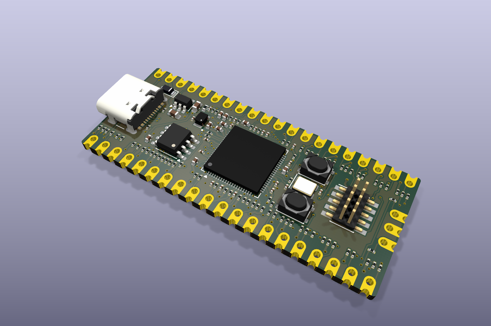
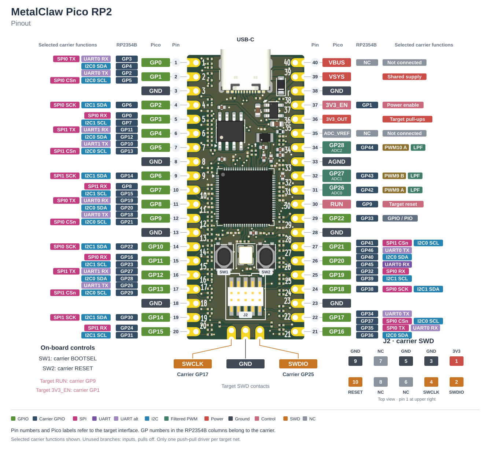

# MetalClaw Pico RP2



An RP2354B board for testing firmware on a Raspberry Pi Pico or Pico 2.
[Metalclaw firmware](https://github.com/renzbagaporo/metalclaw-fw) provides
Python-controlled peripheral emulation and a USB debug probe. The carrier
connects those functions to the target's GPIO, analogue inputs and SWD port.

- Emulate I2C, SPI and UART devices connected to the target.
- Generate and read digital signals on the target's exposed GPIOs.
- Supply filtered PWM stimulus to its three ADC inputs.
- Program and debug the target through SWD; control its reset and regulator enable.

## Hardware

| | |
| --- | --- |
| Controller | RP2354B with 2 MB in-package flash |
| PSRAM | 8 MB, APS6404L-3SQR-SN |
| USB | USB-C, full speed |
| Target interface | Pico / Pico 2 GPIO, power and SWD contacts; 3.3 V GPIO logic |
| Board | 21 × 51 mm, four layers, 1.6 mm, castellated edges |

## Pinout

[](docs/images/pinout.svg)

The **Pico** columns name the target signals; the **RP2354B** columns show
the carrier GPIOs connected to them. The colored function labels belong to
the carrier. J2 programs the carrier; the three contacts at the bottom are
the target's SWD interface.

Several target pins have multiple carrier GPIO branches. Only one push-pull
carrier branch may drive a given target net at a time. GP26–GP28 pass through
permanent analogue filters and do not provide an unfiltered high-speed
digital path. The [full mapping](DESIGN.md#3-authoritative-carrier-to-pico-assignment)
also lists roles supplied through PIO.

## Connections and controls

Connect the carrier to the PC through **J1 USB-C**. The target's own USB port remains
available for its application or console. To enter the carrier's USB
bootloader, hold BOOTSEL, press and release RESET, then release BOOTSEL.
Firmware build instructions and the Python API are in
[metalclaw-fw](https://github.com/renzbagaporo/metalclaw-fw).

### Power

The carrier USB supply feeds the target's VSYS through a Schottky diode.
VSYS also feeds the carrier's regulator, so powering the Pico through its
own USB port powers the carrier too. The two USB VBUS inputs are diode-isolated;
the carrier and target have separate 3.3 V regulators.

The target's `3V3_EN` control disables its regulator while leaving the
carrier powered. Before disabling it, firmware must release all target-facing
GPIO, PWM and SWD outputs and disable their pulls.

## Design files

Open [metalclaw-pico-rp2.kicad_pro](metalclaw-pico-rp2.kicad_pro) in KiCad 9.

- [Schematic](metalclaw-pico-rp2.kicad_sch)
- [PCB layout](metalclaw-pico-rp2.kicad_pcb)
- [Design and pin assignments](DESIGN.md)
- [Assembly instructions](JLCPCB_ASSEMBLY.md)
- [Component sourcing](JLCPCB_SOURCING.md)

Project-local footprints and models are in `footprints/` and `3dmodels/`.

## Manufacturing

Generate the Gerbers, assembly BOM and placement file with:

```sh
python3 tools/gen_fab.py
```

The files are written to `fab/`. Upload `metalclaw-pico-rp2_gerbers.zip` for
the PCB, and `BOM_jlcpcb.csv` / `CPL_jlcpcb.csv` for assembly. The Pico outline
footprint is part of the carrier PCB, not a module to populate.

Order files belong on [tagged releases](https://github.com/renzbagaporo/metalclaw-pico-rp2/releases).
See [release preparation](docs/RELEASING.md) for export and archive details.
