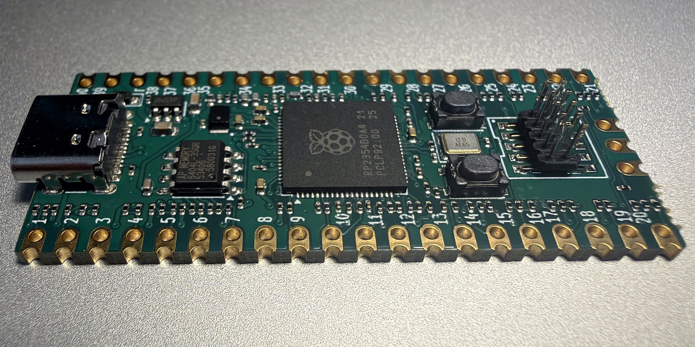
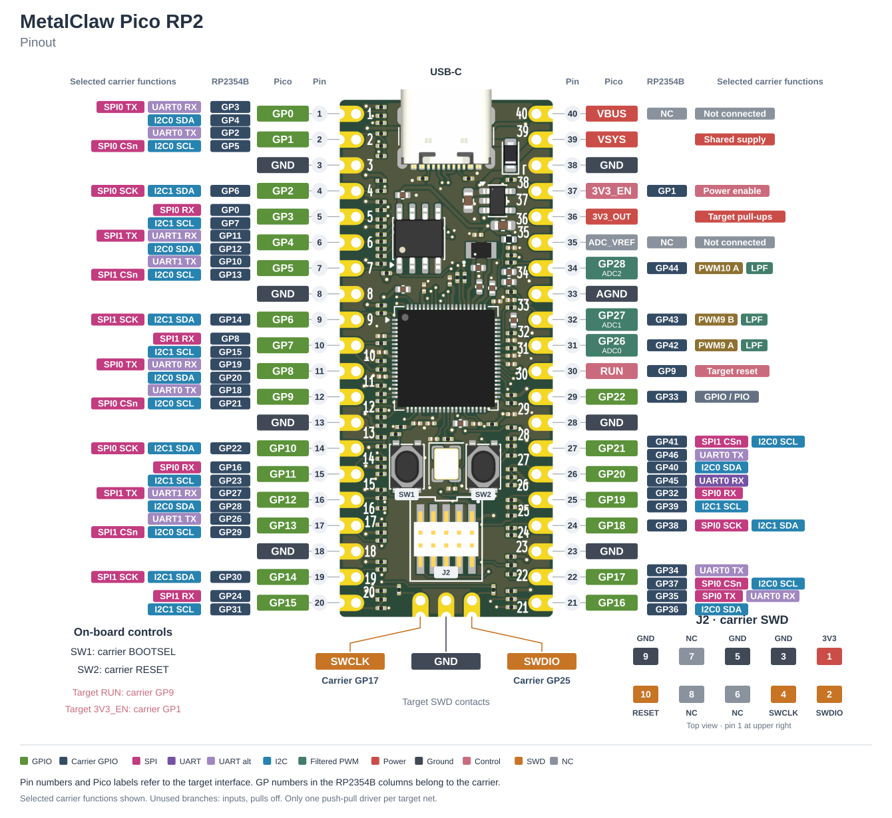

# MetalClaw Pico RP2



An RP2354B hardware-in-the-loop (HIL) test and stimulus carrier in the Raspberry Pi Pico form factor, designed for automated firmware testing on a **Raspberry Pi Pico** or **Pico 2**.

Paired with [metalclaw-fw](https://github.com/renzbagaporo/metalclaw-fw), the carrier provides Python-controlled peripheral emulation, electrical stimulus, power/reset control, and an integrated USB SWD debug probe—all wired directly to the target's GPIO, analogue inputs, and SWD contacts.

## Capabilities

- **Peripheral emulation**: Emulate I2C, SPI, and UART devices across all 26 exposed target GPIOs (`GP0`–`GP22`, `GP26`–`GP28`) using complementary native carrier peripherals supplemented by PIO/SIO.
- **Digital I/O stimulus**: Generate and sample digital signals on the target header through per-branch 100 Ω series isolation resistors.
- **Analogue ADC stimulus**: Drive the target's three ADC inputs (`GP26`–`GP28` / `ADC0`–`ADC2`) using PWM channels through dedicated two-stage RC low-pass filters (~28 kHz −3 dB cutoff).
- **Target debug and power control**: Program and debug the target over SWD (`SWCLK`, `SWDIO`) and control its `RUN` and `3V3_EN` lines directly from the carrier.

## Hardware

| Feature | Specification |
| --- | --- |
| Revision | `v1.r1` |
| Controller | Raspberry Pi RP2354B (QFN-80, 48 GPIOs, 2 MB in-package QSPI flash) |
| External PSRAM | 8 MB, AP Memory `APS6404L-3SQR-SN` on `QMI_CS1n` (`GP47`) |
| Host interface | USB-C, Full-Speed USB (5.1 kΩ CC pull-downs) |
| Carrier debug | 10-pin 1.27 mm Cortex SWD header (`J2`, unshrouded), `BOOTSEL` and `RESET` buttons |
| Target interface | Pico / Pico 2 40-pin + 3-pin SWD footprint (3.3 V logic; 43 stimulus + 4 control/debug lines) |
| Power | Carrier 3.3 V LDO (`AP2112K-3.3`), Schottky diode-isolated VBUS feeding shared `VSYS` |
| Board | 21 × 51 mm, 4-layer, 1.6 mm, single-sided (top) assembly, castellated edges |

## Pinout

[](docs/images/pinout.svg)

The **Pico** columns name the target signals; the **RP2354B** columns show the carrier GPIOs connected to them. Colored tags indicate the carrier's native peripheral roles. **J2** programs and debugs the carrier RP2354B; the three contacts at the bottom edge connect to the target's SWD port.

### Electrical notes

- **Stacked carrier branches**: Several target pins connect to two carrier GPIOs (each with its own 100 Ω series resistor) to maximize native peripheral coverage. Firmware must never enable more than one push-pull carrier driver on the same target net at a time.
- **Analogue filter paths (`GP26`–`GP28`)**: Driven by carrier `GP42`–`GP44` (`PWM9A`, `PWM9B`, `PWM10A`) through permanent two-stage RC filters (330 Ω / 10 nF + 2.2 kΩ / 1.5 nF). These pins do not provide an unfiltered high-speed digital path.
- **Open-drain target controls (`3V3_EN`, `RUN`)**: Carrier `GP1` (`3V3_EN`) and `GP9` (`RUN`) connect through 1 kΩ series resistors and must be driven strictly as active-low open-drain outputs (preload output low, toggle output enable only; never drive high).
- **PSRAM chip select (`GP47`)**: Dedicated to `QMI_CS1n` with a 2.2 kΩ pull-up and not routed to the target header.

## Connections and power

Connect the carrier to the host PC through **J1 (USB-C)**. The target Pico's own USB port remains free for its application or console.

- **Carrier USB bootloader**: Hold `BOOTSEL`, press and release `RESET`, then release `BOOTSEL`.
- **Carrier SWD (`J2`)**: Bare 2×5 1.27 mm header with standard Cortex pinout. The silkscreen notch marks the cable key side (odd-numbered pin row, facing USB-C) as a visual guide only—there is no physical shroud.
- **Firmware & Python API**: Build, flashing, and host control instructions live in [metalclaw-fw](https://github.com/renzbagaporo/metalclaw-fw).

### Power architecture

Carrier USB VBUS feeds the shared `VSYS` rail through a Schottky diode (`D1`), powering both the target and the carrier's 3.3 V regulator (`U1`). Because `VSYS` is shared, powering the target Pico through its own USB port also powers the carrier. Both USB VBUS inputs are diode-isolated, and the carrier and target maintain separate 3.3 V regulators.

Permanent 5.1 kΩ pull-ups on target `GP0`–`GP22` are referenced to the target's `3V3_OUT` (pin 36) rather than the carrier 3.3 V rail so they do not back-power a disabled target.

Pulling `3V3_EN` low disables the target's 3.3 V regulator while keeping the carrier powered. Before disabling it, firmware must return all target-facing GPIO, PWM, and SWD pins to high-impedance and disable their pulls.

## Design files

Open [metalclaw-pico-rp2.kicad_pro](metalclaw-pico-rp2.kicad_pro) in **KiCad 9**.

- [metalclaw-pico-rp2.kicad_sch](metalclaw-pico-rp2.kicad_sch) — schematic
- [metalclaw-pico-rp2.kicad_pcb](metalclaw-pico-rp2.kicad_pcb) — 4-layer PCB layout
- `footprints/` and `3dmodels/` — project-local footprints and STEP/WRL models
- `tools/` — fabrication exporter (`gen_fab.py`), pinout generator (`gen_pinout.py`), and board renderer (`render_board.py`)

## Manufacturing

Ready-to-order fabrication packages are published on [tagged releases](https://github.com/renzbagaporo/metalclaw-pico-rp2/releases).

To regenerate the Gerbers, assembly BOM, and JLCPCB placement file locally (requires KiCad 9 `kicad-cli` and Python 3):

```sh
python3 tools/gen_fab.py
```

Outputs are written to `fab/`:

- `metalclaw-pico-rp2_gerbers.zip` — 4-layer Gerbers and Excellon drill files
- `BOM_jlcpcb.csv` & `CPL_jlcpcb.csv` — top-side assembly BOM (23 lines, 122 parts) and calibrated placement file
- `SOURCE.json` & `SHA256SUMS` — hardware revision, source provenance, and artifact checksums

**Fabrication notes:**

- Enable **castellated holes** (side and bottom edges routed, not V-scored) and **Standard PCBA** (required for 0201 passives and the 0.4 mm-pitch QFN-80); ENIG finish is recommended.
- `A1` is the Pico board-outline and castellated-contact geometry on the carrier PCB itself, not a module to populate.

## License

[CC BY-SA 4.0](LICENSE). See [NOTICE.md](NOTICE.md) for attribution requirements and third-party terms.
